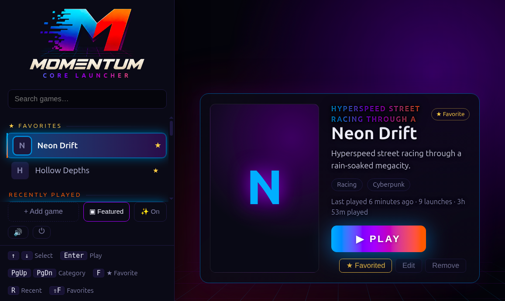
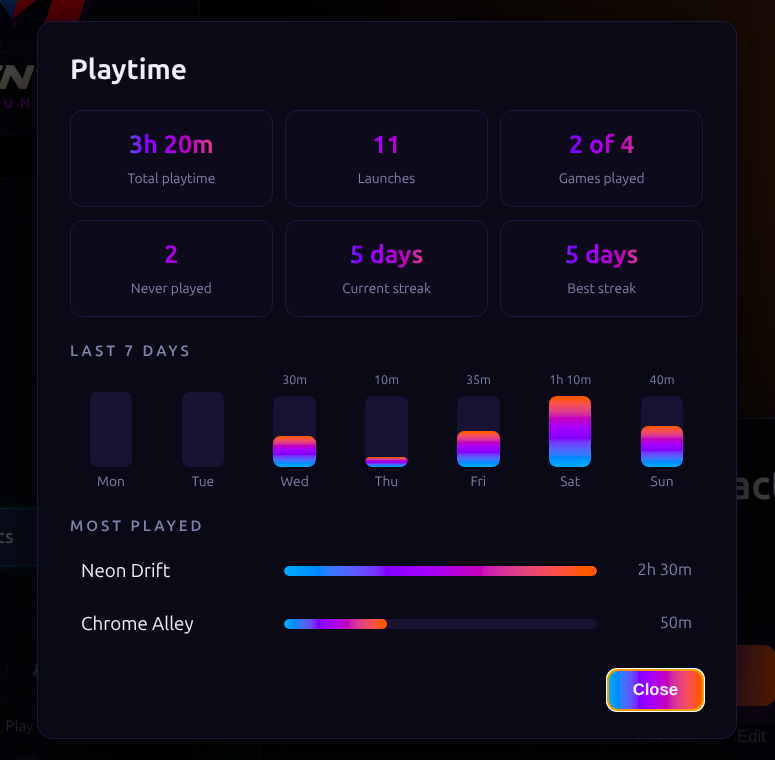

# Momentum Core Launcher





A lightweight local game launcher with an arcade-inspired interface and guided game setup.
Controller-friendly, with a cyberpunk / retro-arcade look, a Python standard-library backend
and a vanilla HTML/CSS/JS front end, shown in a Chrome kiosk or app window.

Features: categories and drag-to-reorder, search, favorites, per-game accent colors, a Classic or
Featured detail panel, synthesized sound effects and intro, gamepad support, play statistics,
per-game launch logs, and artwork/trailer fetching.

## Requirements

- Linux with Python 3.9+ (3.12 tested)
- Google Chrome or Chromium (falls back to `xdg-open`)

## Quick start

```bash
cp games.example.json games.json   # or run ./import_games.py to import .desktop shortcuts
./launch.sh                        # starts the server and opens the launcher
./install.sh                       # optional: add an app-menu / Desktop shortcut
```

Handy keys: **↑/↓** select, **Enter** play, **F** favorite, **R** jump to recent games, **Shift+F** jump to favorites, **S** change sort order, **T** playtime summary, **Ctrl+Q** quit.
An empty library shows a welcome screen with an **Add a game** button. See [USER-GUIDE.md](USER-GUIDE.md) for everything else.

## Meet Momentum Packages

**More time playing. Less time piecing together launch commands.**

[Momentum Packages](https://github.com/jacobm36/momentum-packages) is the companion repository
where we build game-specific setup packages. Each package brings the launch settings, artwork,
game details and installation steps together so Momentum can help turn your own game files
into a playable library entry.

The three projects work together:

- **Momentum Core Launcher** is your arcade front door: choose a game, set it up and hit **PLAY**.
- **Momentum Packages** is the private workshop where packages are built and tested.
- [**Momentum Distribution**](https://github.com/jacobm36/momentum-distribution) hosts the public
  catalog and approved installer downloads. The launcher connects here; players do not need
  access to the private workshop or a GitHub account.

In the launcher, choose **+ Add game**, pick a supported title and point Momentum at your game
files. It downloads and checks the installer, helps set up compatible required software, and
shows you the installation plan before making approved changes. Your original game files stay
untouched. Local package ZIPs can also be imported through **Advanced**.

**Bring your games; Momentum brings the setup.** Packages contain no game data, ROMs or BIOS
files. The catalog currently starts with *The House of the Dead 2*—mouse aiming, zombie chaos
and plenty of clicking. More titles can join as their packages are built and tested; updates
are not installed automatically.

## Your data stays local

`games.json`, `playstats.json`, `logs/`, `jobs/`, `packages/`, `backups/` and `media/` are git-ignored: they hold your personal library,
play history and game artwork. Drop artwork into `media/<game-id>/` (`cover.jpg|png|webp`,
`video.mp4|webm`) or add it from the in-app editor.

## Notes

- Built-in notifications (N), background jobs (I) and backup/restore (B); see the user guide. Jobs keep running after the launcher closes.
- Tests: `python3 -m unittest discover -s tests`.
- Headless package UI tests (Chrome/Chromium): `MCL_BROWSER_TESTS=1 python3 -m unittest tests.test_package_ui_browser`.
- Live public catalog/download-to-install GUI test: `MCL_CATALOG_TESTS=1 python3 -m unittest tests.test_catalog_live_browser` (Chrome/Chromium, internet access, temporary storage, synthetic media and a fake emulator; never touches your real game installation).
- Arcade installer/receipt tests: `MCL_ARCADE_TESTS=1 python3 -m unittest tests.test_arcade_installs`
  (built packages in the sibling package repository, exact Supermodel installation, temporary storage,
  synthetic game files; native missing-software test downloads the pinned official runtime).
- Package check (Package Contract v1): `python3 packages.py check <folder-or-zip>`; nothing in the package is run.
- **Add game** loads the small public catalog from
  [momentum-distribution](https://github.com/jacobm36/momentum-distribution). Choose HOD2 to download
  a fixed installer release, then locate your own game files, review and install.
  **Choose folder...** opens a native Zenity/KDialog folder picker for source and destination
  directories; typed/pasted paths remain available, and cancellation preserves the current path.
  No GitHub sign-in is needed. ZIP size/SHA-256, package identity/digest and platform are checked
  before import; downloading never runs installer code. Downloads are background jobs with
  progress, cancellation and retry. After closing/reopening, choose **Continue setup** in
  **Installs & jobs**, or select the game again. Offline errors are explicit; existing local
  packages remain accessible under **Advanced**. No automatic updates.
- Local package UI: open **Add game → Advanced → Import a local package...** to import a ZIP or local
  package folder, review trust/test evidence, enter paths and run preflight. **Review plan** shows
  exact changes, backups, dependencies and manual setup. Unsupported platforms are blocked.
  Installation is enabled for the tested HOD2 0.1.1 package, its approved artwork revisions 0.1.2 and 0.1.3, and user-scope Flycast v2.7
  build recorded in [target evidence](docs/hod2-target-evidence.json). A different package digest
  or emulator build stays gated. Detection alone is not capability evidence. Work is scoped to
  this HOD2 flow, not a general-purpose package manager.
  Versions 0.1.2 and 0.1.3 inherit gameplay evidence from byte-identical installer code; these are not new gameplay tests.
  Version 0.1.3 restores the original t00ny HOD2 icon with attribution; custom artwork and Steam lookup remain available.
  **Advanced → Add an existing game manually...** retains the original library editor.
- The arcade catalog adds **Virtua Cop 2**, **Star Wars Trilogy Arcade** and **L.A. Machineguns**.
  Virtua Cop 2 uses standalone Flycast, not RetroArch. The other two use a pinned native
  Supermodel release, reused read-only or downloaded into user-scope storage after approval.
  Every new package is tied to its own exact digest/runtime evidence; HOD2 gameplay evidence
  is not transferred. Installer/lifecycle and software prerequisite checks are separate from
  gameplay: all three remain **setup required** until the user confirms play. Settings,
  calibration and saves are isolated per game and retained on removal. L.A. Machineguns
  follows the guide's borderless 1920x1080 X11 layout, not the old fullscreen wrapper.
- Game setup selects its required software automatically; users do not choose an emulator.
  If software is missing, the same game job first requests approval for required downloads,
  checks the installed build, then presents the game-file plan for approval. Detection is read-only.
  Approval can add the official user Flathub remote and install missing user-scope Flycast;
  existing software is reused without an automatic upgrade. Transactions have durable intent/outcome
  records, do not elevate, and finish safely before acknowledging cancellation. An untested installed
  build stops setup before game files change.
- Receipts reconcile approved actions, durable intents, inventories and actual hashes. Catalog
  publication is replayable after interruption without duplicating entries or overwriting later
  personal edits; ambiguous filesystem evidence remains blocked for manual recovery.
- Optional real-package/synthetic-media regression (no real emulator launches):
  `MCL_HOD_PACKAGE=/absolute/HOD-package.zip python3 -m unittest tests.test_hod_receipts`.

- The server binds to `127.0.0.1` only, validates the Host header and requires a per-session token
  for changes.
- Linux only for now (`.desktop` files, `xdg-*` tools).

## License

MIT, see [LICENSE](LICENSE). Game names, covers and trailers belong to their owners and are not
included in this repository.
